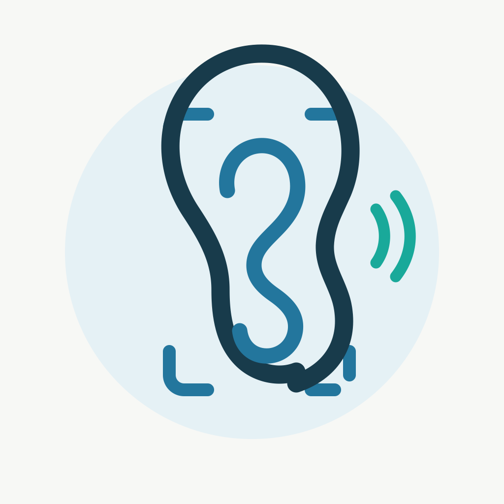

# SightLine ear app icon

Replaced the eye artwork with a clear ear/listening mark in SightLine navy,
blue and teal on its warm off-white and pale-blue background. The ear is the
main silhouette; sound arcs reinforce read-aloud. The master vector is
`ios/icon-design/sightline-ear.svg`.

The icon is now included in the Xcode project's `AppIcon` asset catalog at
1024×1024 and in the PWA/iOS home-screen icons (180, 192 and 512 px). The web
cache version was advanced to `v1.9.1-ear-icon` so installed PWAs receive the
updated files. The Xcode asset catalog compiled successfully into the iOS
simulator app. No OCR, speech, layout or model behavior changed.

